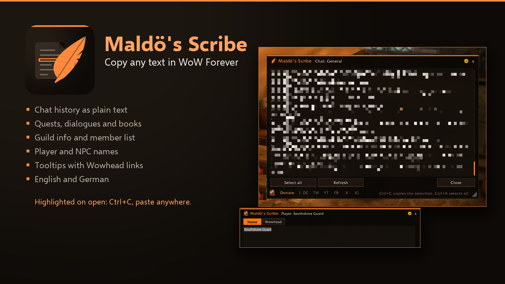
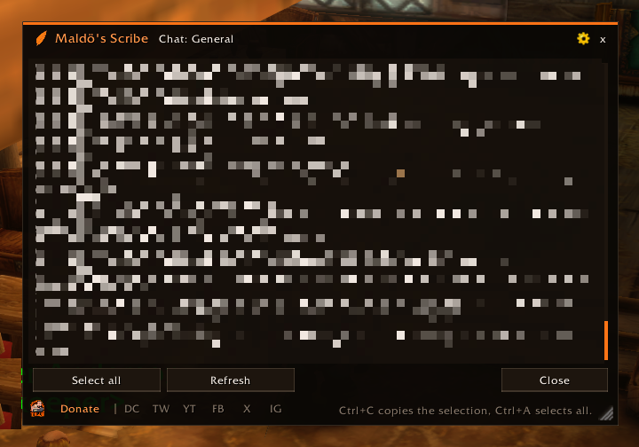
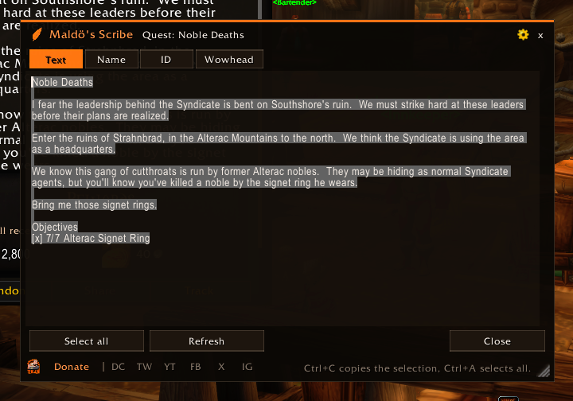
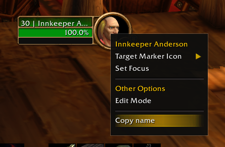
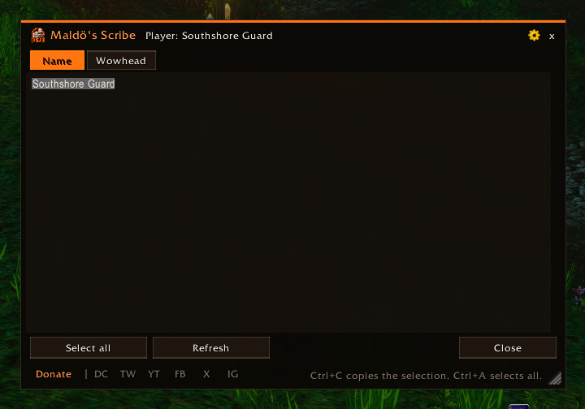
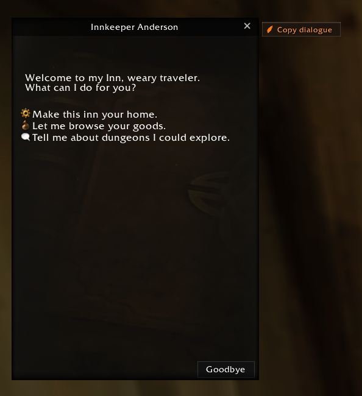
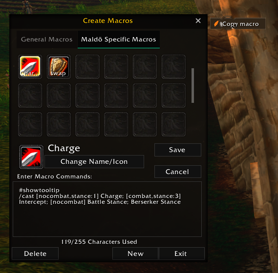
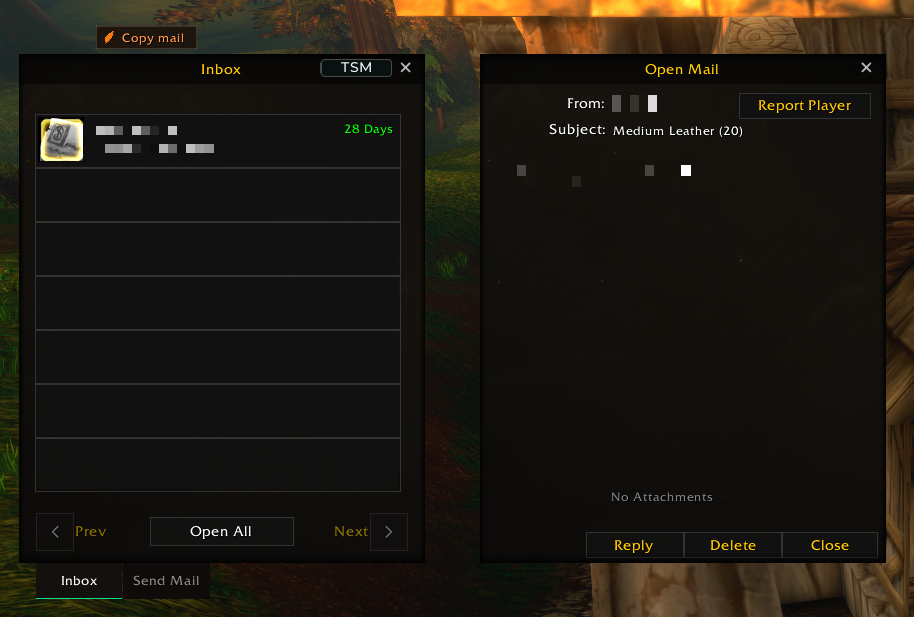
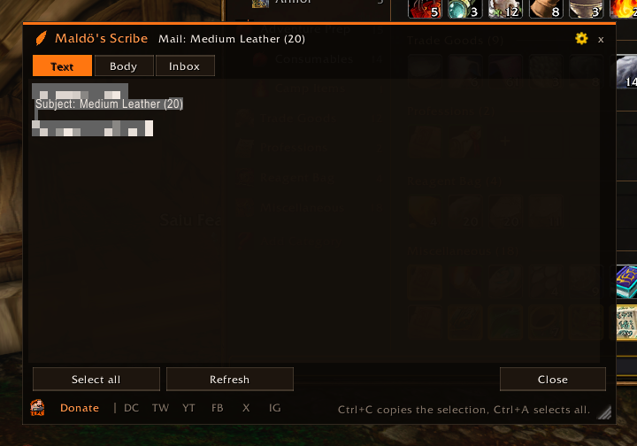
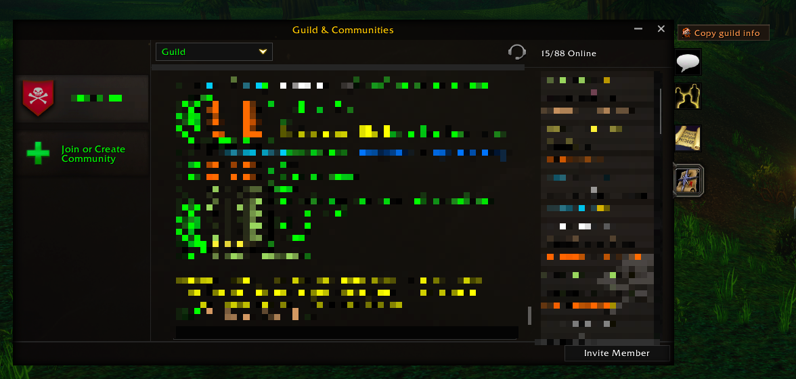

# Maldö's Scribe

Select and copy any text in **WoW Forever**: chat, quests, dialogues, books, guild info, mail, macros,
player and NPC names, tooltips and web addresses.

The game has no clipboard for addons. Maldö's Scribe puts the text into a window where it is already
highlighted: press **Ctrl+C** and paste it anywhere, into Discord, a spreadsheet or a guild forum.

## Features

- **Chat**: a small quill appears in the corner of a chat window while the mouse is over it. One click
  opens the whole history of that window as plain text, with item names instead of links and without icons
  or colour codes. Web addresses in chat are clickable and come up ready to copy.
- **Player and NPC names**: right-click a portrait, a target, a party or raid member, a guild member or a
  name in chat and pick **Copy name**. You get the full name, the first name and the surname; for an NPC the
  Wowhead page, for a Battle.net friend the BattleTag. Alt+click on a name in chat does the same.
- **Quests, dialogues, books**: a **Copy quest** button beside the quest window and the quest log, the same
  beside NPC dialogues, books, plaques and letters. Text, name, id or the Wowhead link.
- **Guild**: a **Copy guild info** button beside the guild window: message of the day, guild information and
  the member list, tab-separated and ready for a spreadsheet.
- **Mail**: a **Copy mail** button above the mailbox: the open letter with sender, subject, text, money and
  attachments, the letter body alone, the draft you are writing, or the whole inbox as a table.
- **Macros and your group**: a **Copy macro** button beside the macro window; `/scribe group` lists the names
  of your party or raid, as a list or as a table with level and class.
- **Items and tooltips**: bind a key and press it while pointing at an item, spell or player: the name, the
  whole tooltip, the id or the Wowhead link. The tooltip that a chat link opens has its own **Copy link**
  button.
- The copy window is movable and resizable and remembers both. Variants (Text, Name, Wowhead, ...) are a row
  of buttons at the top, **Select all** and **Refresh** at the bottom, Escape closes it.
- English and German, following the game client. Every other language uses English.

## Screenshots

| | |
| --- | --- |
|  |  |
|  |  |
|  |  |
|  |  |

Other players' chat and names are pixelated in these pictures.

## Install

Install it from CurseForge like any other addon (game version: WoW Forever), or by hand:

1. Close the game.
2. Unzip the release (`MaldoesScribe-<version>.zip`) into `World of Warcraft\_forever_\Interface\AddOns\`,
   so that the folder `MaldoesScribe` is in there.
3. Start the game and enable the addon.

The addon loads in WoW Forever only.

## How to use

**Buttons beside windows.** Whenever a quest, dialogue, book, guild, mail or macro window is open, a small
button with the quill sits beside it. Click it and the window's text comes up highlighted.

**Chat.** Move the mouse over a chat window and click the quill in its corner. The options let the quill
stay visible all the time, pick its corner, remove timestamps and limit the number of lines.

**Names.** Right-click → **Copy name** in the menus of portraits, targets, group and raid members, guild
members and names in chat. Alt+click on any link in chat (names, items, quests, spells) copies it too; the
modifier can be changed in the options.

**Keys.** Three bindings are offered under Key Bindings → Maldö's Scribe: copy what is open (the tooltip
under the mouse, else the window in front, else the chat), copy the tooltip under the mouse, copy the chat.
None is bound by default. With a key bound, item tooltips show a small hint.

**Commands.** `/copy` does the same as `/scribe`.

| Command | What it does |
| --- | --- |
| `/scribe` | Copy what is open: the tooltip under the mouse, else an open window, else the chat. Closes the window when it is open. |
| `/scribe chat` | Copy the active chat window (`/scribe chat 2` for the second window) |
| `/scribe quest` | Copy the open quest, or the quest selected in the log |
| `/scribe gossip` | Copy the open NPC dialogue |
| `/scribe book` | Copy the open book, plaque or letter |
| `/scribe guild` | Copy the guild information |
| `/scribe mail` | Copy the open letter, the draft or the inbox |
| `/scribe macro` | Copy the open macro |
| `/scribe group` | Copy the names of your party or raid |
| `/scribe tooltip` | Copy the tooltip under the mouse |
| `/scribe options` | Open the options |
| `/scribe keys` | Open the key bindings |
| `/scribe reset` | Put the window back to its place and size |
| `/scribe log` | Show the error report to copy |

If another addon replaces the mail window (TradeSkillMaster's mailing, for example), the mail button is
not there, but `/scribe mail` still gives the inbox while the mailbox is open.

## Options

`/scribe options`: language, window opacity, size and text size, the chat quill (corner, always or on
hover), timestamps, clickable web addresses, the number of chat lines copied, the buttons beside windows,
the "Copy name" menu entry, the key hint in item tooltips, the modifier for clicks on chat links and the
Wowhead address.

## Reporting a problem

If something goes wrong, the addon catches the error and tells you in chat. Type `/scribe log`, press
Ctrl+C in the window that opens, and paste the report into a
[GitHub issue](https://github.com/nfMalde/MaldoesScribe/issues). The report holds the addon and game
version, your settings, the errors and the last log lines. It contains no character names and no chat text.

If a copy button does not react, type `/scribe mouse`, move the mouse over the button and wait three
seconds: the chat then lists the windows under the mouse, which shows what is in the way.

## Development

- `tools/check`: syntax check, text keys and a smoke test that loads the addon in a Lua VM with a stand-in
  for the game API. Needs Node: `cd tools/check`, `npm install`, `npm run check`. The same runs on every
  push.
- `deploy.ps1` copies the addon into the WoW Forever AddOns folder; `release.ps1` builds the zip by hand.
- Changes go through pull requests; `main` only takes merges with a green check.
- Releases are made from the Actions tab (workflow "Release"): it computes the version from the last tag,
  takes the notes from `CHANGELOG.md`, builds the package for review and, after approval, uploads it to
  CurseForge and creates the tag and the GitHub release. The package holds only the addon folder.

## License

GNU General Public License v3.0, see [LICENSE](LICENSE). The Maldö name and the Maldö avatar
(`Media/maldoe.tga`, `docs/logo/maldoe-*.png`) are Maldö's own branding and are not covered by that
licence; please do not reuse them for other projects.

## Support

The addon is free. If you like it, you can support Maldö:
[PayPal](https://www.paypal.com/donate/?hosted_button_id=SVZHLRTQ6H4VL) ·
[Discord](https://discord.gg/GbvU9sns5z) ·
[Twitch](https://www.twitch.tv/maldoe) ·
[YouTube](https://www.youtube.com/@dermaldoe)
